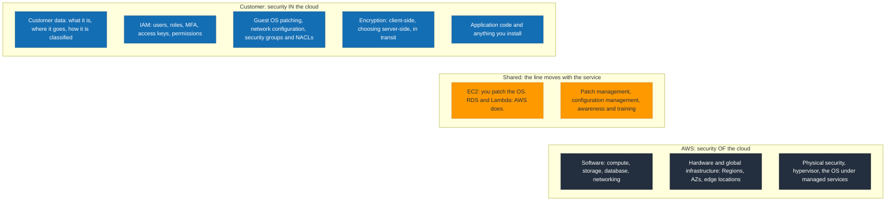
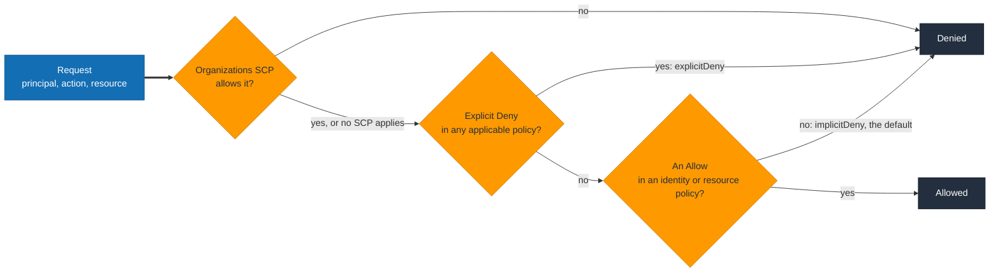

# Domain 2: Security and Compliance (30%)

What it tests: where the shared responsibility line sits for a given service, which IAM construct fits a scenario, and which security service answers a one-line "which tool" question.

## 2.1 Shared responsibility model

**Memorise:** AWS is responsible for security **of** the cloud. The customer is responsible for security **in** the cloud.

| Layer | AWS | Customer | Shared |
|---|---|---|---|
| Physical hosts, data centres, hardware disposal | Yes | | |
| Global infrastructure (Regions, AZs, edge) | Yes | | |
| Hypervisor, managed-service software | Yes | | |
| Network infrastructure (not your VPC config) | Yes | | |
| Guest OS patching and hardening (EC2) | | Yes | |
| Application code and its vulnerabilities | | Yes | |
| Customer data, classification, encryption choices | | Yes | |
| IAM users, roles, policies, MFA | | Yes | |
| Security groups, NACLs, route tables, firewall rules | | Yes | |
| Client-side and server-side encryption config | | Yes | |
| Patch management | | | AWS patches managed services, customer patches EC2 guest OS |
| Configuration management | | | AWS configures its infrastructure, customer configures their resources |
| Awareness and training | | | AWS trains its staff, customer trains theirs |

How the line moves by service:

| Service | AWS does | Customer does |
|---|---|---|
| EC2 | Hypervisor, host hardware, network | Guest OS, patches, SGs, IAM, data, app |
| RDS | OS, DB engine patching, backups (if enabled), failover | Schema, credentials, SG rules, encryption at rest choice, parameter groups |
| Lambda | Runtime, OS, scaling, patching | Function code, IAM execution role, env var secrets, dependencies |
| S3 | Durability, infrastructure, storage encryption mechanism | Bucket policy, ACLs, Block Public Access, versioning, object encryption choice |
| DynamoDB | Everything below the table | IAM access, encryption key choice, data |

- The more managed the service, the more AWS owns. Rank: EC2 < RDS/ECS on EC2 < Fargate < Lambda/S3/DynamoDB.
- Trick questions: "patching the OS of an RDS instance" is AWS. "Patching the OS of an EC2 instance" is customer. "Configuring the security group of either" is customer.
- Customer always owns: data, IAM, encryption decisions, network config inside the VPC.
- AWS always owns: physical, hypervisor, edge locations, the hardware under managed services.

## 2.2 Security, governance and compliance concepts

### Compliance evidence

| Need | Service |
|---|---|
| Download AWS SOC, PCI, ISO reports and sign agreements (BAA, NDA) | **AWS Artifact** |
| Continuous evidence collection mapped to a framework, audit-ready reports | **AWS Audit Manager** |
| Aggregate findings across accounts against CIS, PCI DSS, FSBP standards | **Security Hub** |
| Prove who did what, when, from where | **CloudTrail** |
| Prove a resource was configured a certain way at a given time | **AWS Config** |

- **Memorise:** Artifact is the self-service portal for AWS compliance *reports*. It does not assess *your* compliance.
- Compliance programs by name: SOC 1/2/3, PCI DSS, ISO 27001/27017/27018/9001, HIPAA (via BAA), FedRAMP, GDPR, CSA STAR. The exam asks "where do I get the report", not what the standard says.
- AWS compliance applies to AWS infrastructure. Your workload is compliant only if you configure it to be.

### Encryption

| Mode | Protects | Mechanism | Who configures |
|---|---|---|---|
| In transit | Data moving over a network | TLS/SSL, HTTPS endpoints, VPN, ACM certificates | Customer chooses to use HTTPS endpoints; AWS provides them |
| At rest | Stored data | KMS keys, SSE-S3, SSE-KMS, SSE-C, EBS encryption, RDS encryption | Customer enables; AWS performs |

- Services that encrypt at rest with a tick box or default: S3 (default SSE-S3 since 2023), EBS, RDS, DynamoDB, Redshift, EFS, SQS, Glacier (always).
- RDS: encryption at rest must be chosen at creation. Cannot be enabled on an existing unencrypted instance in place; snapshot, copy encrypted, restore (SAA depth; CLF only asks that encryption at rest exists).
- Client-side encryption: customer encrypts before upload; AWS never sees the plaintext key.

| | KMS | CloudHSM |
|---|---|---|
| Tenancy | Multi-tenant managed service | Single-tenant hardware appliance in your VPC |
| Key control | AWS manages the HSMs, you manage keys and policies | You manage everything including users on the HSM |
| Validation | FIPS 140-2 Level 3 | FIPS 140-2 Level 3 |
| Integration | Native with ~all AWS services | Via custom key store, PKCS#11, JCE, CNG |
| Keyword in question | "managed", "integrated with S3/EBS/RDS", "audit key use in CloudTrail" | "dedicated hardware", "regulatory requirement to control the HSM", "single tenant" |

- KMS key types: AWS owned (invisible), AWS managed (`aws/s3` etc, free, rotated yearly), customer managed (you create, you pay, you set rotation).
- Deleting a customer managed key has a 7 to 30 day waiting period.

### Logging and audit, three services the exam conflates

| | CloudTrail | AWS Config | CloudWatch Logs |
|---|---|---|---|
| Records | API calls: who, what, when, from where | Resource configuration state and changes over time | Application and system log output |
| Question | "Who deleted the bucket?" | "Was this SG ever open to 0.0.0.0/0?" "Is every EBS volume encrypted?" | "What did my app print at 03:14?" |
| Unit | Event | Configuration item, evaluated by rules | Log event in a log stream in a log group |
| Enabled by default | 90 days of management events in the console, yes; a trail to S3, no | No | No, agent or service integration |
| Compliance role | Accountability | Compliance as code, remediation | Operational troubleshooting |

- **Memorise:** CloudTrail = audit of actions. Config = audit of state. CloudWatch = metrics, logs, alarms.
- CloudTrail can log data events (S3 object-level, Lambda invoke) but that is off by default.
- CloudTrail Lake and CloudTrail Insights exist; Insights flags unusual API activity volume.

### Governance

| Concept | What it is |
|---|---|
| Least privilege | Grant only the permissions a task needs. The default answer to any "how should permissions be set" question. |
| AWS Organizations | Multi-account management: consolidated billing, OUs, SCPs. |
| Service control policy (SCP) | Guardrail on an OU or account. Sets the maximum permissions available. Does not grant anything. Does not affect the management account. |
| Control Tower | Opinionated landing zone on top of Organizations: account factory, guardrails (preventive via SCP, detective via Config). |
| Tagging | Cost allocation, access control via ABAC, automation. Tag policies enforce via Organizations. |
| Data residency | Data stays in the Region you put it in. AWS does not replicate across Regions unless you configure it. |
| Choosing a Region | Compliance and data sovereignty first, then latency, then service availability, then price. |

- SCP + IAM: effective permissions are the intersection. An SCP deny cannot be overridden by an IAM allow.
- Organizations gives consolidated billing, volume discount tiers pooled across accounts, and shared Reserved Instance / Savings Plan benefits.

## 2.3 Access management

Read it left to right and the three rules fall out: default is deny, an
explicit deny beats every allow, and an SCP caps what the account can do even
for its administrators. Permissions boundaries and session policies also have
to allow, but that is SAA depth. The root user skips identity policies
entirely, which is why it gets MFA and no keys.

### Root user

- Created with the account, identified by the account email. Has unrestricted access that no policy can limit.
- **Memorise:** do not use it day to day, enable MFA on it, no access keys for it, lock the credentials away.
- Only root can: change the account email and root password, change the support plan, close the account, restore IAM user permissions if an admin locks everyone out, register as a seller in the Reserved Instance Marketplace, enable MFA Delete on an S3 bucket, change some billing settings such as activating IAM access to billing, sign up for GovCloud.

### MFA types

| Type | Example |
|---|---|
| Virtual MFA device | Authenticator app on a phone |
| FIDO security key | YubiKey, passkey |
| Hardware TOTP token | Key fob from a vendor |
| SMS | Not supported for IAM users |

### IAM building blocks

| Construct | Is | Use when |
|---|---|---|
| User | Long-term identity with password and/or access keys | A specific human or legacy app that cannot use roles |
| Group | Collection of users, policies attach here | Managing people by job function. Groups cannot nest and cannot be a principal in a policy. |
| Role | Identity with no long-term credentials, assumed for temporary credentials | EC2 instance, Lambda function, cross-account access, federated users. Always prefer over access keys on a server. |
| Policy | JSON document of Effect, Action, Resource, Condition | The only thing that actually grants or denies |

| Policy type | Attached to | Specifies principal | Example |
|---|---|---|---|
| Identity-based | User, group, role | No, the principal is implied | "This role can read bucket X" |
| Resource-based | Resource (S3 bucket, SQS queue, KMS key, Lambda) | Yes, must name the principal | "Account 123 can read this bucket" |
| Permissions boundary | User or role | No | Cap on what an identity policy can grant |
| SCP | OU or account | No | Cap across an account |
| Session policy | Passed at AssumeRole time | No | Further narrow a session |

| | AWS managed | Customer managed | Inline |
|---|---|---|---|
| Maintained by | AWS | You | You |
| Reusable | Yes, across accounts | Yes, within account | No, one-to-one with its identity |
| When | Quick start, common jobs (`ReadOnlyAccess`, `AdministratorAccess`) | Exact least privilege | Policy must be deleted with the identity |

**Memorise, policy evaluation:**
1. Default is implicit deny.
2. An explicit **Deny** anywhere wins over any Allow.
3. Otherwise an Allow is needed from an identity-based or resource-based policy.
4. SCPs and permissions boundaries must also allow; they never grant on their own.

### Identity services

| | IAM | IAM Identity Center | Cognito |
|---|---|---|---|
| For | Workforce, single account, fine-grained | Workforce, many accounts and SaaS apps, SSO | Customers of your app |
| Source of identities | IAM users or federation | Built-in directory, Active Directory, external IdP via SAML | User pools, or social/enterprise IdPs |
| Keyword | "permissions", "role", "policy" | "single sign-on", "multiple accounts", "one login" | "mobile app users", "sign up / sign in", "social login" |

| Cognito | User pool | Identity pool |
|---|---|---|
| Does | Authentication: directory of app users, sign up, MFA, social login, returns JWT | Authorization: swaps a token for temporary AWS credentials via STS |
| Keyword | "sign-in page for my app" | "let app users upload directly to S3" |

- STS issues temporary credentials: AssumeRole, AssumeRoleWithSAML, AssumeRoleWithWebIdentity, GetSessionToken. Default role session 1 hour, up to 12 hours.
- Federation: corporate IdP via SAML 2.0 or OIDC. Users never get IAM users. IAM Identity Center is the preferred front door.
- Cross-account access: create a role in account B trusting account A, grant account A's identities `sts:AssumeRole` on it. No shared credentials.

### Credential hygiene

| Tool | Does |
|---|---|
| Credential report | Account-wide CSV: every user, key age, last use, MFA status |
| Access Advisor | Per identity: which services were actually used and when, to trim policies |
| IAM Access Analyzer | Finds resources shared with external principals, validates policies, generates least-privilege policies from CloudTrail |
| Account password policy | Length, complexity, expiry, reuse prevention, applies to IAM users |
| Access key rotation | Two keys allowed per user so you can rotate with no downtime |

- Never embed access keys in code or AMIs. Use roles. Git-committed keys are the canonical exam anti-pattern.
- Instance profile = the wrapper that lets an EC2 instance assume a role.

## 2.4 Security components and services

### Detection and protection

| Service | Does | Keyword in question |
|---|---|---|
| **GuardDuty** | Threat detection from CloudTrail, VPC Flow Logs, DNS logs, EKS and S3 logs using ML and threat intel | "unusual API activity", "compromised credentials", "crypto mining", "continuous monitoring for threats", no agent |
| **Inspector** | Vulnerability scanning of EC2, container images in ECR, Lambda: CVEs and network reachability | "vulnerabilities", "CVE", "unpatched software", "software on my instances" |
| **Macie** | Finds sensitive data (PII, credentials) in **S3** using ML | "PII in S3", "sensitive data discovery", "data classification" |
| **Security Hub** | Aggregates findings from the above plus partners, scores against standards | "single pane", "consolidated view", "CIS benchmark" |
| **Detective** | Investigates the root cause of a GuardDuty finding, builds a behaviour graph | "investigate", "root cause", "how did it happen" |
| **WAF** | Layer 7 rules on CloudFront, ALB, API Gateway, AppSync: SQLi, XSS, IP, geo, rate limiting | "SQL injection", "block a country", "rate-based rule", "HTTP" |
| **Shield Standard** | Free, automatic layer 3/4 DDoS protection on every account | "DDoS", no cost, "always on" |
| **Shield Advanced** | Paid, 24/7 DDoS Response Team, cost protection against scaling charges from an attack, WAF included for protected resources | "DDoS response team", "cost protection", "large sophisticated attack" |
| **Firewall Manager** | Centrally manage WAF, Shield Advanced, SG, Network Firewall rules across Organizations accounts | "across all accounts", "centrally manage firewall rules" |
| **Network Firewall** | Managed stateful layer 3 to 7 firewall for the VPC, IDS/IPS, domain filtering | "inspect traffic between VPCs", "Suricata rules", "outbound domain allowlist" |
| **Certificate Manager (ACM)** | Provision, manage, auto-renew public and private TLS certificates for ELB, CloudFront, API Gateway | "HTTPS", "SSL certificate", "renew" |
| **Trusted Advisor** | Checks across cost, performance, security, fault tolerance, service limits, operational excellence. Core security checks free: open SG ports, S3 public buckets, root MFA, IAM use, EBS/RDS public snapshots. Full set needs Business or Enterprise support. | "best practice recommendations", "unrestricted ports" |
| **VPC Flow Logs** | Metadata of IP traffic accepted or rejected at VPC, subnet or ENI level, to CloudWatch Logs or S3. No payload. | "why was traffic blocked", "which IPs talked to my instance" |

**Memorise, which scanner:**
- Threats and behaviour (what is *happening*): GuardDuty.
- Vulnerabilities in software (what is *exploitable*): Inspector.
- Sensitive data in S3 (what is *stored*): Macie.
- All of them in one place: Security Hub. Why it happened: Detective.

### Secrets

| | Secrets Manager | Systems Manager Parameter Store |
|---|---|---|
| Rotation | Built in, with Lambda, native for RDS, Redshift, DocumentDB | None built in |
| Cost | Per secret per month plus API calls | Standard tier free, Advanced tier charged |
| Encryption | Always KMS | Optional: SecureString uses KMS |
| Keyword | "rotate database credentials automatically" | "configuration values", "store a parameter", "free" |

### Network controls

| | Security group | Network ACL |
|---|---|---|
| Scope | ENI / instance | Subnet |
| State | Stateful: return traffic allowed automatically | Stateless: inbound and outbound rules both needed |
| Rules | Allow only | Allow and deny |
| Evaluation | All rules evaluated | Numbered rules evaluated in order, first match wins |
| Default | Deny all inbound, allow all outbound | Default NACL allows all both ways; custom NACL denies all |
| Keyword | "instance-level firewall", "allow port 443 from the ALB" | "block a specific IP address", "subnet-level" |

- To block one malicious IP: NACL deny rule. A security group cannot deny.
- Flow Logs show REJECT entries, useful for debugging which of the two blocked traffic.

## Self-test

1. Who patches the guest OS of an Amazon RDS instance?
2. Which service lets you download AWS's PCI DSS attestation of compliance?
3. A company must prove a dedicated, single-tenant hardware module stores its keys. KMS or CloudHSM?
4. Which service answers "who terminated instance i-0abc at 02:00"?
5. Which service answers "has any security group ever allowed SSH from 0.0.0.0/0"?
6. An IAM user has an Allow for `s3:*` and the account SCP denies `s3:DeleteBucket`. Can the user delete a bucket?
7. Name two actions only the root user can perform.
8. An EC2 application needs to write to DynamoDB. Access keys in a config file, or a role?
9. Which service finds unencrypted credit card numbers sitting in S3 objects?
10. You need to block a single IP address from reaching a subnet. Security group or NACL?

Answers:
1. AWS. RDS is managed; customer patches EC2 guest OS, not RDS.
2. AWS Artifact.
3. CloudHSM.
4. CloudTrail.
5. AWS Config (with a managed rule such as `restricted-ssh`).
6. No. An SCP deny caps the account; explicit deny always wins.
7. Any two of: change the account email or root password, change the support plan, close the account, enable S3 MFA Delete, register as an RI Marketplace seller, restore IAM permissions.
8. A role via an instance profile. Never long-term keys on an instance.
9. Amazon Macie.
10. NACL. Security groups cannot deny.
