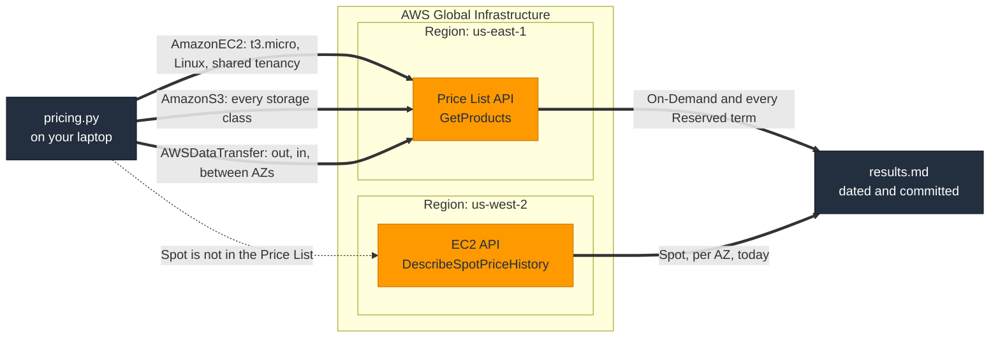

# C2: Pricing API

**Proves:** what On-Demand, Standard and Convertible Reserved Instances across
1 and 3 years and three payment options actually cost relative to each other,
for one instance, from the Pricing API. Plus S3 storage classes side by side
and the data transfer tiers. The course slides say "up to 72%"; this says what
it is for `t3.micro` in your region on the day you ran it.

**Cost:** none. The Pricing API is free to call.

**Time:** 60 to 75 minutes including the write-up.

## How it fits together



The prices are for us-west-2 but the API that publishes them lives in
us-east-1. Spot prices come from EC2 itself in the Region being priced,
because they change by the minute and are not a price list.

## Steps

- [ ] 1. Environment.
  ```bash
  cd projects/c2-pricing-api && python3 -m venv .venv && source .venv/bin/activate && pip install -r requirements.txt
  ```
- [ ] 2. Run it. The Pricing API lives in `us-east-1` regardless of which region you price; the script handles that.
  ```bash
  python pricing.py --region us-west-2 --instance-type t3.micro | tee results.md
  ```
- [ ] 3. Read the Reserved table. Check three things against [notes/04](../../notes/04-billing-pricing-support.md) section 4.1: 3-year beats 1-year, All Upfront beats No Upfront, Standard beats Convertible, and by how much in each case.
- [ ] 4. Spot, for comparison. The Pricing API does not publish Spot; EC2 does:
  ```bash
  aws ec2 describe-spot-price-history --region us-west-2 --instance-types t3.micro --product-descriptions "Linux/UNIX" --start-time "$(date -u +%Y-%m-%dT%H:%M:%SZ)" --query 'SpotPriceHistory[].[AvailabilityZone,SpotPrice]' --output table
  ```
  Append the output to `results.md` under a heading, with the date.
- [ ] 5. Storage classes. In the S3 table, order the classes by price and check the order matches the retrieval-time order in [notes/03](../../notes/03-technology-services.md) section 3.6. Cheaper storage means slower or costlier retrieval.
- [ ] 6. Data transfer. Confirm from the table that inbound is zero, that outbound tiers get cheaper with volume, and what cross-AZ traffic costs per GB in each direction.

## Write-up

Append to `results.md`:

- Best Reserved option by effective hourly, and its percentage saving against On-Demand.
- The Spot discount against On-Demand for the cheapest AZ, on that day.
- Which storage class is cheapest per GB-month and what the catch is.
- One sentence: why Savings Plans exist when RIs already do.

These are the only cost figures allowed into this repository, because they
came through the API. Date them.

## Teardown

Nothing to tear down. Delete `.venv` if you like.
