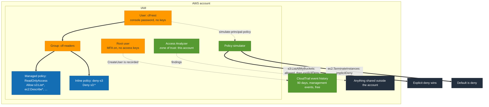

# C3: IAM hygiene

**Proves:** an explicit deny beats any allow, and the default is deny, shown
with the policy simulator rather than a diagram. Along the way: root MFA, the
credential report, Access Analyzer and CloudTrail event history, which is what
the exam means by "who did what".

**Cost:** none. IAM, Access Analyzer and CloudTrail's 90-day event history are
free.

**Time:** 45 minutes including teardown.

Does not overlap S7 in the SAA repo, which is Organizations, SCPs and Config.

## How it fits together



Orange is an identity, blue is a policy, green is something that observes
rather than grants. The user never holds a policy directly: it inherits the
allow and the deny through the group, and the deny wins.

## Steps

Replace `ACCOUNT` with the output of
`aws sts get-caller-identity --query Account --output text`.

- [ ] 1. Root. Confirm MFA is on the root user and it has no access keys.
  ```bash
  aws iam get-account-summary --query 'SummaryMap.[AccountMFAEnabled,AccountAccessKeysPresent]'
  ```
  Expect `[1, 0]`. If not, fix it in the console as root before anything else.
- [ ] 2. Credential report. Who has a password, who has keys, when each was last used.
  ```bash
  aws iam generate-credential-report && sleep 5 && aws iam get-credential-report --query Content --output text | base64 -d | cut -d, -f1,4,5,9,11,16 | column -t -s,
  ```
- [ ] 3. Password policy.
  ```bash
  aws iam get-account-password-policy
  ```
  If it returns `NoSuchEntity`, the account is on the default policy. Set one in the console (length, complexity, expiry) and re-run.
- [ ] 4. Group and user. Console → IAM. Create group `clf-readers` with the AWS managed policy `ReadOnlyAccess` attached. Create user `clf-test`, console access, autogenerated password, add to the group. Do not create access keys.
  ```bash
  aws iam list-attached-group-policies --group-name clf-readers && aws iam get-group --group-name clf-readers --query 'Users[].UserName'
  ```
- [ ] 5. Simulate. What can `clf-test` do?
  ```bash
  aws iam simulate-principal-policy --policy-source-arn arn:aws:iam::ACCOUNT:user/clf-test --action-names s3:ListAllMyBuckets ec2:TerminateInstances s3:PutObject --query 'EvaluationResults[].[EvalActionName,EvalDecision]' --output table
  ```
  Record each decision. `implicitDeny` is the default-deny rule: nothing allowed it.
- [ ] 6. Add an explicit deny. Console → the group → Add inline policy, JSON:
  ```json
  {"Version": "2012-10-17", "Statement": [{"Effect": "Deny", "Action": "s3:*", "Resource": "*"}]}
  ```
  Name it `deny-s3`. Re-run step 5. `s3:ListAllMyBuckets` should now be `explicitDeny` even though `ReadOnlyAccess` allows it.
- [ ] 7. Access Analyzer. Console → IAM → Access Analyzer → Create analyzer, zone of trust the current account. Wait a minute, then:
  ```bash
  aws accessanalyzer list-analyzers --query 'analyzers[].[name,status]' && aws accessanalyzer list-findings --analyzer-arn "$(aws accessanalyzer list-analyzers --query 'analyzers[0].arn' --output text)" --query 'findings[].[resourceType,resource,status]' --output table
  ```
  Any finding is a resource shared outside the account. Expect none, or a public S3 bucket if one is still up from another repo.
- [ ] 8. CloudTrail. Find yourself creating the user.
  ```bash
  aws cloudtrail lookup-events --lookup-attributes AttributeKey=EventName,AttributeValue=CreateUser --max-results 3 --query 'Events[].[EventTime,Username,EventName]' --output table
  ```
  This is event history: 90 days, management events only, free, no trail needed. A trail to S3 is what you create when you need longer retention or data events.

## Write-up

`results.md`:

- Root MFA and key status, credential report row count, whether a password policy existed.
- The three simulator decisions before and after the deny, as a table.
- Access Analyzer finding count and what any finding was.
- The CloudTrail row showing the CreateUser event, with the time.
- One line: the policy evaluation order in your own words.

## Teardown

[TEARDOWN.md](TEARDOWN.md). Do it the same evening; the user has a console
password.
