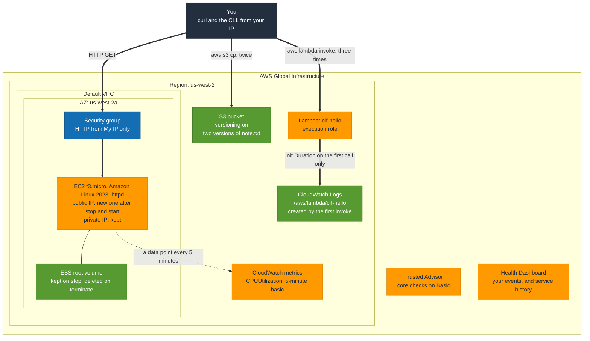

# C4: Service tour

**Proves:** what the four services the exam asks about most actually look like
when touched: S3 versioning keeps the old object, a stopped EC2 instance keeps
its EBS volume and loses its public IP, a terminated one loses both, Lambda
writes to CloudWatch Logs without being asked, and basic monitoring is
five-minute. One evening, torn down the same evening.

**Cost:** pennies if torn down tonight. What bills while it exists: the public
IPv4 address on the instance (hourly), the EBS root volume (monthly, pro rata),
the instance itself beyond the Free Tier allowance. Nothing else here bills at
this scale.

**Time:** 70 minutes including teardown.

Region: whichever one the SAA repo's S0 sweeper covers, so it can confirm the
teardown. Replace `BUCKET` with a globally unique name.

## How it fits together



Trusted Advisor and the Health Dashboard sit outside the Region because they
are account-level. Everything you create tonight is inside one Region and one
AZ, which is also the list of what to tear down.

## Steps

- [ ] 1. S3. Create a bucket, upload, version, upload again.
  ```bash
  aws s3 mb s3://BUCKET && echo one > note.txt && aws s3 cp note.txt s3://BUCKET/ && aws s3api put-bucket-versioning --bucket BUCKET --versioning-configuration Status=Enabled && echo two > note.txt && aws s3 cp note.txt s3://BUCKET/ && aws s3api list-object-versions --bucket BUCKET --query 'Versions[].[Key,VersionId,IsLatest,StorageClass]' --output table
  ```
  Two versions, one latest, both Standard. Note that versioning cannot be disabled once enabled, only suspended.
- [ ] 2. EC2. Console → Launch instance: Amazon Linux 2023, `t3.micro`, default VPC, new security group allowing HTTP from My IP only, no key pair needed. User data:
  ```bash
  #!/bin/bash
  dnf install -y httpd && echo "hello from $(hostname)" > /var/www/html/index.html && systemctl enable --now httpd
  ```
  Wait for status checks, then:
  ```bash
  aws ec2 describe-instances --filters Name=instance-state-name,Values=running --query 'Reservations[].Instances[].[InstanceId,InstanceType,PublicIpAddress,Placement.AvailabilityZone]' --output table
  ```
  `curl http://PUBLIC_IP/` should return the hostname line. Record the public IP.
- [ ] 3. Stop, then start. Console → Instance state → Stop. Wait for stopped. Start it. Re-run the checkpoint from step 2. Record the new public IP. It changed because there is no Elastic IP; the private IP and the EBS volume did not change. This is the exam's stop-versus-terminate question.
- [ ] 4. CloudWatch. Console → CloudWatch → Metrics → EC2 → Per-instance → CPUUtilization for the instance. Note the data point interval. Basic monitoring is five minutes; detailed is one minute and costs extra.
- [ ] 5. Lambda. Console → Create function `clf-hello`, Python, default execution role. Keep the default handler. Deploy. Then:
  ```bash
  aws lambda invoke --function-name clf-hello --payload '{}' /dev/stdout && aws logs describe-log-groups --log-group-name-prefix /aws/lambda/clf-hello --query 'logGroups[].[logGroupName,storedBytes]' --output table
  ```
  The log group was created by the first invocation, by the execution role. Invoke it twice more and look at the `Duration` and `Init Duration` lines in the log stream: the first has an init, the rest do not.
- [ ] 6. Trusted Advisor. Console → Trusted Advisor. Record which categories show checks and which say they need a Business or Enterprise plan.
- [ ] 7. Health. Console → AWS Health Dashboard. Note the two tabs: your account's events, and the service-level history. The public Service Health Dashboard is the second one without logging in.
- [ ] 8. Tear down. [TEARDOWN.md](TEARDOWN.md), tonight.
- [ ] 9. Sweep. From the SAA repo: `bash ~/projects/aws-saa-projects/s0-cost-sweeper/sweep.sh` and confirm nothing from this evening appears.

## Write-up

`results.md`:

- S3: the two version IDs and which was latest.
- EC2: instance ID, AZ, public IP before and after the stop, private IP before and after.
- CloudWatch: the metric interval you observed.
- Lambda: Init Duration on the first invocation, Duration on the third.
- Trusted Advisor: categories available on your plan.
- One line each: what stop keeps, what terminate keeps, what a Lambda needs a role for.
- The sweeper output after teardown.
